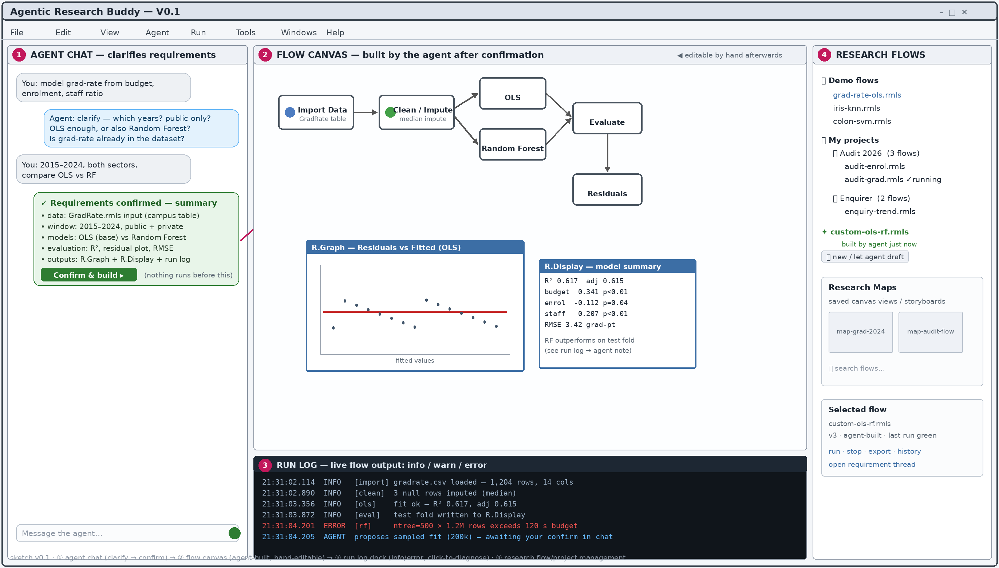

# Agentic Research Buddy (WIP)

> **Work in progress.** This repository is an experiment, not a released product. Parts of it
> are unfinished, the interface is still being built, and things will move. Pull it if you
> want to watch the work — not because it is ready to use.

Chat with an AI agent about your local CSV data. With a provider configured, the agent
proposes an analysis flow, you confirm it, an embedded engine runs it, and a run log shows
every step. Local-first, single-process desktop app: no account, no server, no telemetry.
The only network call is the LLM provider you configure — and none is configured out of the
box, so the app ships in its offline mode until you point it at an endpoint.

## The target UI



`ui-sketch.png` is the expectation, not the shipped state. The picture shows the four
regions the app is being built around:

1. **Agent chat** — the agent clarifies the request and hands back a requirements card that
   the human confirms. Nothing runs before that confirmation.
2. **Flow canvas** — the flow the agent built, laid out as a graph and editable by hand
   afterwards.
3. **Run log** — the live output of a run, `info` / `warn` / `error`, clickable to diagnose a
   failing node.
4. **Research flows** — demo flows, your projects, saved canvas maps, and the flow selected
   right now.

**Current implementation is behind this sketch.** Treat the image as the direction of
travel, not as a screenshot of the app.

## What is in the repo today

- **Flow engine** (`core.engine`) — typed node executors, a scheduler, and a confirm gate
  that is a structural invariant in the engine core, not a UI convention.
- **Node registry** (`core.registry`) — node types with typed parameter descriptors, so new
  nodes can be added without touching the engine.
- **Agent loop** (`agent`) — provider adapters (a deterministic offline double, a shipped
  demo provider, and any OpenAI-compatible endpoint), grounded and citable responses, and
  staged proposals the human applies or declines. The agent can never mutate a flow
  directly.
- **Desktop UI** (`ui`) — Swing shell on FlatLaf: chat panel, canvas, log dock, library.
- **Workspace persistence** (`core.persist`) — flows as JSON, run logs as JSONL, datasets as
  CSV.
- **Demos** — three shipped read-only flows (OLS and a seeded forest on a grad-rate table,
  k-NN on iris, SVM on the colon dataset). Their CSVs are in
  `src/main/resources/demo/data/`; the app resolves a dataset by file name inside the run
  directory, so copy the CSV you want into your workspace before running that demo.
- **Legacy `.rmls` import** — import-only slice: legacy flows whose nodes map to registry
  equivalents import as buildable flows; unknown legacy nodes import as inert placeholders
  with warnings, so nothing is silently dropped. Export is not implemented yet. The test
  fixtures under `src/test/resources/legacy/` are inert XML — the importer reads their
  structure and never executes them.
- **Packaging** — a per-user Windows installer and an application image, both bundling the
  runtime.

## Build

Requires Temurin JDK 25 and Maven 3.10. The one command that compiles, runs the test
suites, checks formatting, and writes the coverage report:

```powershell
scripts\verify.ps1
```

or, directly:

```bash
mvn -B clean verify
```

## Run

Build the packaged app (the runtime is bundled, so no JDK is needed on the machine that
runs it):

```bash
mvn -B -Pinstaller -Dinstaller.cfg=scripts/installer-appimage.cfg clean package
target/installer/AgenticResearchBuddy/AgenticResearchBuddy.exe workspace
```

Drop the `-Dinstaller.cfg` flag to build the per-user MSI instead — that leg needs the WiX
toolset extension on the build machine (`wix extension add -g WixToolset.Util.wixext`) and
is the less travelled path. The packaged launcher also runs a headless smoke pass —
`AgenticResearchBuddy.exe smoke <workspace-dir>` — and `scripts/install-smoke.ps1` walks
install, launch, demo run, artifacts, uninstall, and asserts no surviving process.

## Agent providers are configuration

`fake` (deterministic offline double), `demo` (the shipped honest canned reply), or any
OpenAI-compatible chat endpoint — same loop, same grounding, byte for byte. When the
provider is unreachable the app says so and disables the agent input; every other capability
keeps working.

What leaves the machine: with the shipped `demo` provider, nothing. With a configured
provider, the request carries the conversation, the registry digest, and the first rows of
each dataset — that is the one thing that goes over the wire. The API key is read from an
environment variable, never written to the workspace, and never recorded in the run log.

## How this repository was made

This project is also an experiment in a **create harness**: a multi-agent loop with typed
roles, human decision gates, and review/verification passes, used to take the project from
intent to a working first milestone. The harness and its working notes are not part of this
public repository — only the code it produced is. The point of sharing it here is the
code, and the picture of where it is going.

## Status

WIP. The first milestone (engine, gate, canvas, library, agent loop, log dock, demos,
packaging) is in place and the test suite is green, but the application is still being
built towards the sketch above. Expect rough edges, missing pieces, and changing APIs.

## Licence

This project's own code is MIT — see [LICENSE](LICENSE).

One dependency is not: the SVM node uses [Smile](https://github.com/haifengl/smile) 4.3.0,
which is GPL-3.0, and it pulls in native maths libraries (OpenBLAS, ARPACK — BSD-3) that
are GPL-family or permissive. This repository publishes **source only**, so nothing is
redistributed here. If you build the installer and distribute the result, those licence
terms apply to the bundle. See [THIRD-PARTY-LICENSES.txt](THIRD-PARTY-LICENSES.txt) for the
dependency list.
